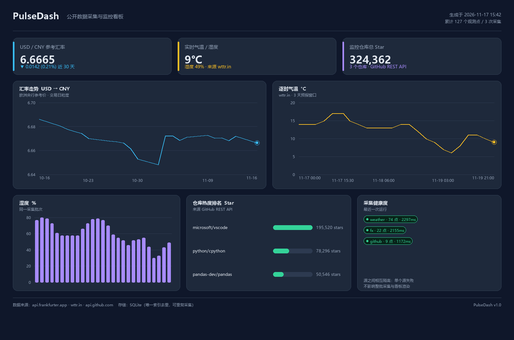
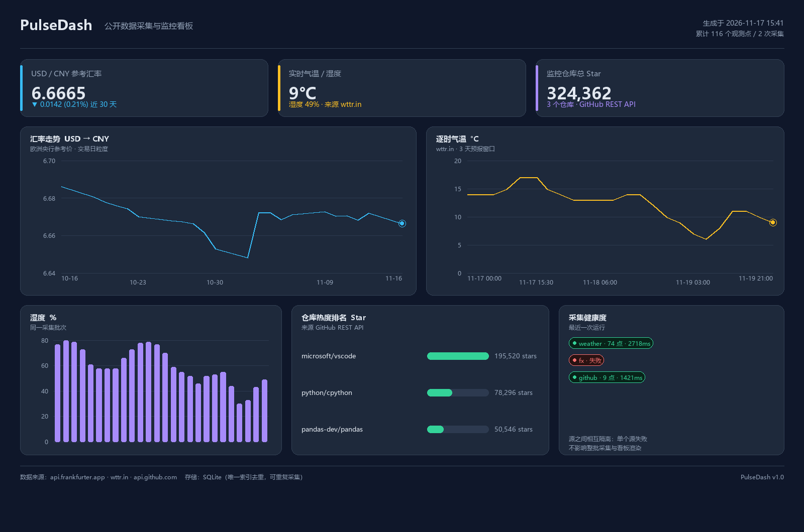

# PulseDash · 公开数据采集与监控看板

把网页上零散的公开数据采下来、存进去、画成一张能直接发给老板看的看板。
三个示例数据源开箱即用：**汇率、天气、GitHub 仓库指标**。换源只改配置。



---

## 它解决什么问题

需要盯着的公开数据通常是这样的：汇率要去一个网站看，天气去另一个，项目热度还得手工数 star。
想做周报、想做异常提醒，就得先有人把这些数字抄到表格里——这件事每天都得重复一遍，而且抄错了没人发现。

PulseDash 把这条链路做成一次配置、反复运行：

```
采集 → 落库（去重）→ 出图 / 出 HTML
```

跑一次是一条新的时间点，跑一百次是一条趋势线。

---

## 快速开始

```bash
pip install -r requirements.txt

python run.py             # 采集 + 出图
python run.py --collect   # 只采集
python run.py --report    # 只出图（用库里已有数据）
```

产物在 `out/`：`dashboard.png`（发群/进周报）和 `dashboard.html`（可交互查看）。
数据库是 `out/pulsedash.sqlite3`，可以直接用任何 SQLite 客户端查。

---

## 架构

```
datadash-pulse/
├── config.json      # 数据源开关、城市、币种、监控仓库、HTTP 策略
├── sources.py       # 采集层：HttpClient（重试/退避/限速）+ 三个 Collector
├── storage.py       # 持久层：SQLite，唯一索引幂等写入
├── charts.py        # 绘图原语：折线、柱状、条形排名、状态徽章（纯 Pillow）
├── report.py        # 渲染层：1600×1060 看板 PNG + 自包含 HTML
├── run.py           # 入口：采集 → 落库 → 渲染
└── out/             # 产物目录（图片、HTML、SQLite）
```

数据流只有一条直线，没有隐藏状态：

```
Collector.fetch() ──► list[Point] ──► Store.add_points() ──INSERT OR IGNORE──► SQLite
                                                                                  │
                          dashboard.png ◄── report.render() ◄── Store.series() ◄───┘
```

---

## 几个关键设计

### 1. 源之间强隔离：一个源挂了，看板照样出

每个采集器独立 try/except，失败只记状态、不中断整批。下面这张就是**故意让汇率源失败**时的输出：
看板照常渲染，`采集健康度` 里红徽章直接指出挂的是哪个源。



这意味着：定时任务里不会因为某个网站临时抽风，导致整天的数据都断掉。

### 2. 重复采集不会产生重复数据

`points` 表上有唯一索引 `(source, metric, ts)`，写库统一走 `INSERT OR IGNORE`。
同一小时跑十次，库里还是一个点；换台机器补采历史，也不会把曲线弄脏。

### 3. 重试是有边界的

- 网络错误、超时、5xx → 指数退避重试，最多 3 次（800ms → 1.6s → 3.2s）
- **4xx 直接失败不重试** —— 请求本身有问题，重试只是浪费对方资源
- 每个请求之间强制最小间隔 300ms，不做"高频骚扰式"采集

### 4. 不依赖绘图库

所有坐标轴、网格、刻度、标签都是手绘的，只依赖 Pillow。
好处很实在：不用装 matplotlib（省几十 MB 和字体配置），输出完全确定——同样的数据跑两次，像素一模一样，方便做版本对比。

### 5. 新增一个数据源 ≈ 20 行

继承 `Collector` 实现 `fetch()`，返回 `list[Point]`，然后在 `build_collectors()` 里注册：

```python
class HackerNewsCollector(Collector):
    name = "hn"

    def fetch(self) -> list[Point]:
        ids = self.http.get_json("https://hacker-news.firebaseio.com/v0/topstories.json")[:10]
        now = int(datetime.now(timezone.utc).timestamp())
        points = []
        for rank, item_id in enumerate(ids):
            item = self.http.get_json(
                "https://hacker-news.firebaseio.com/v0/item/%d.json" % item_id)
            points.append(Point(self.name, "score_rank_%02d" % rank, now,
                                float(item.get("score", 0)), item.get("title", "")))
        return points
```

存储、去重、重试、限速、出图全部自动继承，不用改任何其他文件。

---

## 数据源

| 源 | 接口 | 指标 | 认证 |
|---|---|---|---|
| 汇率 | `api.frankfurter.app` | `rate_USD_CNY` 日线 | 无需 |
| 天气 | `wttr.in` | 逐时气温 / 湿度 / 风速 | 无需 |
| 仓库 | `api.github.com` | stars / forks / open_issues | 可选 token（限速 60→5000 次/小时） |

全部为公开、无需密钥的接口，克隆下来就能跑。

---

## 已知限制

- 汇率源只有交易日数据，周末会断点，曲线是折线连接而非插值补齐（宁可留空态也不编数据）
- 天气源返回的是城市本地时间，代码里按 UTC 偏移换算；换城市要同步调整 `utc_offset_hours`
- GitHub 未带 token 时受 60 次/小时限速，仓库多了需要串行等待
- 当前为单机 SQLite，适合单机定时任务；多实例并发写入需要换 PostgreSQL 或加文件锁

## 下一步

- [ ] 加 `--watch` 模式，按 cron 间隔常驻采集
- [ ] 阈值告警（任一指标准差超限就推送 Webhook / 邮件）
- [ ] 图表交互（HTML 端换成 ECharts，保留 PNG 作为静态摘要）
- [ ] 源健康度进库，做"采集成功率"趋势图

---

## 技术栈

Python 3.10+ · 标准库（urllib / sqlite3 / json / argparse）· Pillow（仅绘图）
无 Web 框架、无 ORM、无绘图库以外的第三方依赖。
